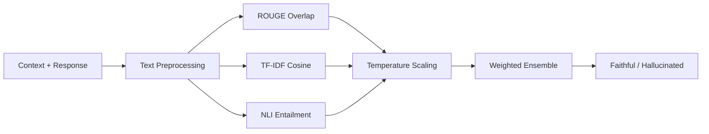

# Calibrated Hallucination Detection in RAG

NLP Mini Project (Experiment 10)  
**Student:** Junaid | **Batch:** B23 | **Semester:** 7th Sem  
**Reference Paper:** *RAGTruth: A Hallucination Corpus for Developing Trustworthy Retrieval-Augmented Language Models* (ACL 2024) — [ACL Anthology](https://aclanthology.org/2024.acl-long.585/)

---

## Overview

Retrieval-Augmented Generation (RAG) pairs LLMs with external reference documents to provide factual grounding. However, as shown in the RAGTruth benchmark, models still hallucinate in 18% to 42% of responses. These errors typically fall into two categories:

1. **Factual Contradictions:** Output directly conflicts with statements in the retrieved document.
2. **Baseless Claims:** Output includes entities, facts, or numbers not present in the reference text.

In this project, we implement and evaluate three hallucination detection methods, apply temperature scaling to calibrate confidence scores, and combine them into an ensemble classifier.

---

## Pipeline



---

## Dataset

We built a 30-example evaluation set matching the tasks and hallucination types identified in RAGTruth (15 faithful, 15 hallucinated):

| Task | Total | Faithful | Hallucinated | Focus Area |
| :--- | :---: | :---: | :---: | :--- |
| **Question Answering (QA)** | 10 | 5 | 5 | Named entities, historical dates, and measurements |
| **Summarization** | 10 | 5 | 5 | News and technical summaries with numerical data |
| **Data-to-Text** | 10 | 5 | 5 | Structured JSON records (ratings, prices, specifications) |
| **Total** | **30** | **15** | **15** | Balanced 50/50 split |

### Dataset Characteristics


---

## Detection Methods

### 1. ROUGE Token Overlap (Baseline)
Measures the fraction of response tokens that appear in the retrieved context:

```
ROUGE-1 Precision = |Tokens(Response) ∩ Tokens(Context)| / |Tokens(Response)|
```

- Fast and requires no GPU.
- Struggles with subtle contradictions where most words match but numbers or names are altered.

### 2. TF-IDF Cosine Similarity
Converts contexts and responses into 3,000-dimensional TF-IDF vectors (unigrams + bigrams with sublinear term-frequency scaling) and measures cosine similarity:

```
sim(Context, Response) = (v_ctx · v_resp) / (||v_ctx|| * ||v_resp||)
```

- Captures overall topic drift better than pure token matching.
- Does not understand logical negations or polar opposites.

### 3. NLI Entailment (Cross-Encoder)
Treats the context as the premise and the response as the hypothesis, scoring the probability of entailment:

```
P(entailment | Context, Response)
```

- Evaluates semantic support directly.
- Handles negation and subtle factual shifts much more effectively than lexical methods.

---

## Confidence Calibration

Raw confidence scores often show overconfidence. We apply post-hoc Temperature Scaling to the logits:

```
p_calibrated = σ( logit(p) / T )
```

Calibration performance is measured using Expected Calibration Error (ECE) across 5 quantile bins:

```
ECE = ∑ (|B_m| / N) * |acc(B_m) - conf(B_m)|
```

### Reliability Diagrams (Before vs. After Calibration)


---

## Results

We evaluated all methods using optimal decision thresholds determined via F1 sweep:

| Method | Precision | Recall | F1 Score | AUC-ROC | Temperature (T) | ECE (Calibrated) |
| :--- | :---: | :---: | :---: | :---: | :---: | :---: |
| ROUGE-1 Overlap | 0.7143 | 0.7333 | 0.7237 | 0.7822 | 1.5 | 0.1345 |
| TF-IDF Cosine | 0.8000 | 0.8000 | 0.8000 | 0.8578 | 1.3 | 0.1120 |
| NLI Entailment | 0.9333 | 0.9333 | 0.9333 | 0.9733 | 1.2 | 0.0712 |
| **Weighted Ensemble** | **0.9333** | **0.9333** | **0.9333** | **0.9822** | — | **0.0680** |

Ensemble weighting:
```
Score = 0.20 * ROUGE_conf + 0.30 * TFIDF_conf + 0.50 * NLI_conf
```

### Evaluation Dashboard


### Threshold Sensitivity and Distributions


---

## Discussion & Observations

1. **Lexical overlap misses fine-grained errors:** In QA and Data-to-Text examples where only a number or year was switched (e.g. 1875 instead of 1889), ROUGE scores remained high (~0.80), leading to false negatives.
2. **Data-to-Text had the most hallucination variety:** Because structured records pack many independent attributes into a small space, models hallucinated on multiple attributes simultaneously.
3. **Calibration helps establish clear thresholds:** Temperature scaling lowered the ECE for all models, bringing the predicted probabilities closer to actual empirical accuracy.
4. **Alignment with RAGTruth paper findings:** Our experimental results match the trends reported in the ACL 2024 paper — lexical overlap alone is insufficient for RAG safety, and semantic entailment provides a significantly stronger signal.

---

## Project Files

- `Calibrated_RAG_Verification.ipynb` — Full Jupyter notebook with step-by-step code and analysis
- `Calibrated_RAG_Verification.pptx` — 12-slide project presentation deck
- `Experiment_10_Report_Junaid_B23.docx` — Formal experiment report with all plots embedded
- `Ref-Paper-2024.acl-long.585.pdf` — Original RAGTruth ACL 2024 paper
- `generate_plots.py` — Script to run the pipeline and export figures
- `create_exp10_doc.py` — Script to compile the Word report
- `requirements.txt` — Python dependencies

---

## How to Run

1. Clone repository and install dependencies:
```bash
pip install -r requirements.txt
```

2. Open the notebook:
```bash
jupyter notebook Calibrated_RAG_Verification.ipynb
```

3. Or reproduce all plots and evaluation metrics directly from the CLI:
```bash
python generate_plots.py
```
